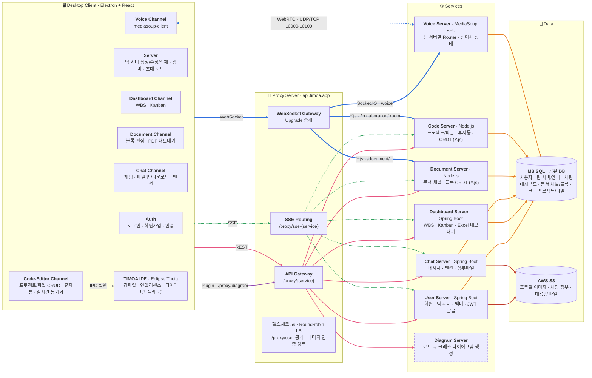

# TIMOA — Team Integrated Management Organization Assistance

> 팀 단위 실시간 협업 플랫폼 · Visual Studio Live Share + Discord + Notion + Trello 통합

---

## 프로젝트 개요

TIMOA는 개발 팀을 위한 올인원 협업 환경을 제공합니다. 흩어져 있던 협업 도구들을 하나의 데스크탑 애플리케이션으로 통합하여, 팀원들이 별도의 창 전환 없이 코딩·소통·문서화·프로젝트 관리를 동시에 수행할 수 있습니다.

| 통합 대상 | 제공 기능 |
|-----------|-----------|
| Visual Studio Live Share | 실시간 코드 동시 편집 (CRDT) |
| Discord | 채널 기반 채팅 + 팀 음성 통화 |
| Notion | 블록 기반 문서 협업 (동시 편집) |
| Trello / Jira | WBS · 칸반보드 대시보드 |

---

## 주요 기능

- **실시간 코드 협업** — Eclipse Theia 기반 IDE + Y.js CRDT로 여러 사용자가 동시에 같은 코드를 편집
- **실시간 문서 편집** — Notionblock.js + Y.js CRDT 기반 블록 에디터, 슬래시 커맨드·드래그 앤 드롭 지원
- **팀 음성 통화** — MediaSoup SFU 기반 WebRTC 음성 통화, 방화벽 환경에서도 안정적 동작
- **채팅** — REST + SSE 기반 실시간 채팅, 파일·이미지 첨부 (AWS S3)
- **대시보드** — WBS · 칸반보드, REST + SSE 기반 실시간 동기화

---

## 시스템 구성

| 선 | 프로토콜 | 사용처 |
|---|---|---|
| 🩷 실선 | **REST** | 모든 CRUD 요청 (`/proxy/{service}`), 파일 업로드 (`/chat-upload`, `/user-upload`) |
| 💚 점선 | **SSE** | 서버 → 클라이언트 변경 알림 (User · Dashboard · Chat · Document · Code) |
| 💙 굵은 선 | **WebSocket** | Y.js CRDT 동기화 (Code · Document), Socket.IO 시그널링 (Voice) |
| 💙 점선 | **WebRTC** | 음성 미디어. Proxy를 거치지 않고 SFU로 직접 전송 |
| 🧡 | **SQL** | 단일 MS SQL 공유 DB ([ADR 0003](https://github.com/TIMOA-MAIN/TIMOA_Docs/blob/main/decisions/architecture/0003-shared-db.md)) |
| ❤️ | **S3** | User(프로필 이미지 · 파일), Chat(첨부파일) |
| 💜 | **Plugin** | TIMOA IDE 플러그인 → Diagram Server (`/proxy/diagram`) |

> Diagram Server는 Proxy에 라우팅(`/diagram`)만 등록되어 있고 이 조직에 레포가 없어 점선 테두리로 표시했습니다.

전체 아키텍처 세부 사항 → [`architecture/overview.md`](./architecture/overview.md)

---

## 아키텍처 결정 기록 (ADR)

TIMOA의 주요 기술 선택과 그 근거를 ADR(Architecture Decision Record) 형식으로 기록합니다.

### 아키텍처 레벨

| 번호 | 제목 | 상태 |
|------|------|------|
| [0001](./decisions/architecture/0001-msa-architecture.md) | MSA 지향 아키텍처 채택 | 승인됨 |
| [0002](./decisions/architecture/0002-reverse-proxy-nodejs.md) | NGINX 대신 Node.js로 Reverse Proxy 구현 | 승인됨 |
| [0003](./decisions/architecture/0003-shared-db.md) | 단일 공유 DB 유지 결정 | 미완성 |
| [0004](./decisions/architecture/0004-protocol-mixed.md) | 서비스별 통신 프로토콜 혼용 결정 | 승인됨 |

### 서비스 전환 레벨

| 번호 | 제목 | 상태 |
|------|------|------|
| [0005](./decisions/service/0005-document-server-migration.md) | 문서 서버 Spring Boot + STOMP → Node.js + Y.js CRDT 전환 | 승인됨 |
| [0006](./decisions/service/0006-theia-adoption.md) | 코드 에디터 Monaco + 자체 LSP → Eclipse Theia 전환 | 승인됨 |
| [0007](./decisions/service/0007-notionblock-adoption.md) | 문서 에디터 단순 React → Notionblock.js 전환 | 승인됨 |
| [0008](./decisions/service/0008-stomp-removal.md) | STOMP 완전 제거 결정 | 승인됨 |

### 통신 프로토콜 레벨

| 번호 | 제목 | 상태 |
|------|------|------|
| [0009](./protocol/0009-chat-rest-sse.md) | 채팅에 WebSocket 대신 REST + SSE 채택 | 승인됨 |
| [0010](./protocol/0010-voice-sfu-mediasoup.md) | 음성 통화에 P2P 대신 SFU(MediaSoup) 채택 | 승인됨 |
| [0011](./protocol/0011-crdt-yjs.md) | 실시간 동시 편집에 CRDT(Y.js) 채택 | 승인됨 |
| [0012](./protocol/0012-dashboard-rest-sse.md) | 대시보드 동기화에 REST + SSE 채택 | 승인됨 |

### 데이터 레벨

| 번호 | 제목 | 상태 |
|------|------|------|
| [0013](./data/0013-file-s3-migration.md) | 파일 저장 Base64 + MS SQL → AWS S3 전환 | 승인됨 |
| [0014](./data/0014-s3-unstructured-data.md) | 비정형 데이터 AWS S3 버킷 분리 결정 | 승인됨 |

### 외부 연동 레벨

| 번호 | 제목 | 상태 |
|------|------|------|
| [0015](./integration/0015-notion-api-fallback.md) | Notion API 연동 시도 → API Key 제약으로 내부 구현 전환 | 대체됨 |

---

## 기술 스택

| 영역 | 기술 |
|------|------|
| **클라이언트** | Electron · React · TypeScript · Vite |
| **Node.js 서버** | Node.js · Express · Y.js · MediaSoup · http-proxy-middleware |
| **Java 서버** | Java · Spring Boot · JPA · SSE |
| **실시간 동기화** | Y.js CRDT · WebSocket · SSE (Server-Sent Events) |
| **음성 통화** | WebRTC · MediaSoup (SFU) · OPUS 코덱 |
| **코드 에디터** | Eclipse Theia · VS Code Extension API |
| **문서 에디터** | Notionblock.js |
| **데이터베이스** | MS SQL Server |
| **파일 스토리지** | AWS S3 |
| **Reverse Proxy** | Node.js + http-proxy-middleware |

---

## 서비스 목록

| 서비스 | 언어 | 프로토콜 | 설명 |
|--------|------|----------|------|
| [Proxy Server](https://github.com/TIMOA-MAIN/Proxy_Server) | Node.js | HTTP / WS | 헬스체크 기반 동적 라우팅, LB |
| [Code Server](https://github.com/TIMOA-MAIN/Code_Server) | Node.js | WebSocket | Eclipse Theia + Y.js CRDT 코드 편집 |
| [Document Server](https://github.com/TIMOA-MAIN/Document_Server) | Node.js | WebSocket | Y.js CRDT 문서 동시 편집 |
| [Voice Server](https://github.com/TIMOA-MAIN/Voice_Server) | Node.js | WebRTC | MediaSoup SFU 음성 통화 |
| [Chat Server](https://github.com/TIMOA-MAIN/Chat_Server) | Java | REST + SSE | 실시간 채팅, AWS S3 파일 |
| [Dashboard Server](https://github.com/TIMOA-MAIN/Dashboard_Server) | Java | REST + SSE | WBS · 칸반보드 |
| [User Server](https://github.com/TIMOA-MAIN/User_Server) | Java | REST | 사용자 인증·관리 |
| [Desktop Client](https://github.com/TIMOA-MAIN/Desktop_Client) | TypeScript | — | Electron 데스크탑 클라이언트 |

---

## 아키텍처 현황 및 개선 방향

현재 아키텍처와 목표 아키텍처의 차이는 [`architecture/as-is.md`](./architecture/as-is.md)와 [`architecture/to-be.md`](./architecture/to-be.md)에 상세히 기술되어 있습니다.

주요 미완성 항목:
- 서비스별 DB 분리 (현재: 단일 MS SQL 공유)
- Redis 기반 서비스 간 이벤트 통신
- AWS CloudFront CDN 연동 (현재: S3 직접 접근)
- 컨테이너화 (Docker · Kubernetes)
