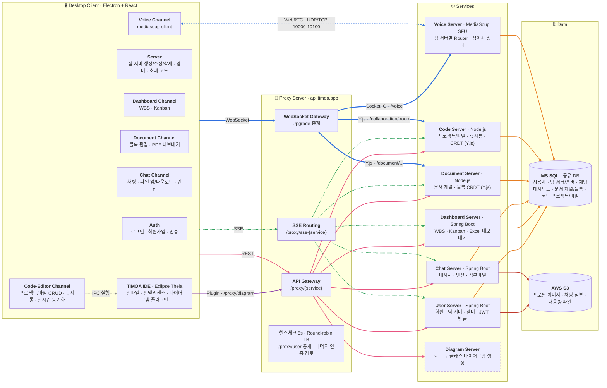

# 전체 시스템 구성도

## 개요

TIMOA는 MSA 지향 아키텍처를 채택한 실시간 협업 플랫폼입니다. 각 기능 도메인이 독립 서비스로 분리되어 있으며, 서비스별 특성에 맞는 프로토콜과 기술 스택을 선택했습니다.

관련 결정: [0001 MSA 아키텍처 채택](../decisions/architecture/0001-msa-architecture.md) · [0004 프로토콜 혼용](../decisions/architecture/0004-protocol-mixed.md)

---

## 시스템 구성도

| 선 | 프로토콜 | 사용처 |
|---|---|---|
| 🩷 실선 | **REST** | 모든 CRUD 요청 (`/proxy/{service}`), 파일 업로드 (`/chat-upload`, `/user-upload`) |
| 💚 점선 | **SSE** | 서버 → 클라이언트 변경 알림 (User · Dashboard · Chat · Document · Code) |
| 💙 굵은 선 | **WebSocket** | Y.js CRDT 동기화 (Code · Document), Socket.IO 시그널링 (Voice) |
| 💙 점선 | **WebRTC** | 음성 미디어. Proxy를 거치지 않고 SFU로 직접 전송 |
| 🧡 | **SQL** | 단일 MS SQL 공유 DB ([ADR 0003](https://github.com/TIMOA-MAIN/TIMOA_Docs/blob/main/decisions/architecture/0003-shared-db.md)) |
| ❤️ | **S3** | User(프로필 이미지 · 파일), Chat(첨부파일) |
| 💜 | **Plugin** | TIMOA IDE 플러그인 → Diagram Server (`/proxy/diagram`) |

> Diagram Server는 Proxy에 라우팅(`/diagram`)만 등록되어 있고 이 조직에 레포가 없어 점선 테두리로 표시했습니다.

---

## 서비스 상세

### Proxy Server
| 항목 | 내용 |
|------|------|
| 언어 | Node.js |
| 라이브러리 | http-proxy-middleware |
| 역할 | 클라이언트 요청 라우팅, 로드밸런싱, 헬스체크, WebSocket Upgrade 중계 |
| 프로토콜 | HTTP (라우팅) + WebSocket Upgrade 중계 |
| 특이사항 | 런타임 동적 라우팅 테이블 갱신, 장애 서버 자동 제외·복구 시 재편입 |

> NGINX 대신 Node.js를 선택한 근거 → [0002](../decisions/architecture/0002-reverse-proxy-nodejs.md)

---

### Code Server
| 항목 | 내용 |
|------|------|
| 언어 | Node.js |
| 프레임워크 | Eclipse Theia |
| 실시간 동기화 | Y.js CRDT + y-websocket |
| 프로토콜 | WebSocket |
| 역할 | 실시간 코드 동시 편집, 인텔리센스(VS Code Extension), 코드 실행 |

> Eclipse Theia 채택 근거 → [0006](../decisions/service/0006-theia-adoption.md)  
> CRDT 채택 근거 → [0011](../protocol/0011-crdt-yjs.md)

---

### Document Server (CRDT)
| 항목 | 내용 |
|------|------|
| 언어 | Node.js |
| 라이브러리 | Y.js · y-websocket · Notionblock.js |
| 프로토콜 | WebSocket |
| 역할 | 블록 기반 문서 동시 편집, 커서 위치 공유, 문서 상태 영속화 |

> Spring Boot → Node.js 전환 근거 → [0005](../decisions/service/0005-document-server-migration.md)  
> Notionblock.js 채택 근거 → [0007](../decisions/service/0007-notionblock-adoption.md)

---

### Voice Server
| 항목 | 내용 |
|------|------|
| 언어 | Node.js |
| 라이브러리 | MediaSoup (C++ 코어) |
| 프로토콜 | WebRTC + WebSocket (시그널링) |
| 역할 | SFU 기반 다중 사용자 음성 통화 |
| 코덱 | OPUS 48kHz |
| 구조 | Transport · Producer · Consumer · Router · Room |

> SFU(MediaSoup) 채택 근거 → [0010](../protocol/0010-voice-sfu-mediasoup.md)

---

### Chat Server
| 항목 | 내용 |
|------|------|
| 언어 | Java |
| 프레임워크 | Spring Boot |
| 프로토콜 | REST (메시지 전송) + SSE (메시지 수신) |
| 역할 | 채널 채팅, 파일·이미지 첨부 |
| 파일 스토리지 | AWS S3 |

> REST + SSE 채택 근거 → [0009](../protocol/0009-chat-rest-sse.md)  
> S3 전환 근거 → [0013](../data/0013-file-s3-migration.md)

---

### Dashboard Server
| 항목 | 내용 |
|------|------|
| 언어 | Java |
| 프레임워크 | Spring Boot · JPA (Cascade) |
| 프로토콜 | REST (CRUD) + SSE (변경 이벤트 전파) |
| 역할 | WBS · 칸반보드 섹션·Row·카드 관리 및 실시간 동기화 |

> REST + SSE 채택 근거 → [0012](../protocol/0012-dashboard-rest-sse.md)

---

### User Server
| 항목 | 내용 |
|------|------|
| 언어 | Java |
| 프레임워크 | Spring Boot |
| 프로토콜 | REST |
| 역할 | 사용자 인증·계정 관리 |

---

## 프로토콜 요약

| 서비스 | 클라이언트 → 서버 | 서버 → 클라이언트 |
|--------|-------------------|-------------------|
| Code Server | WebSocket (Y.js) | WebSocket (Y.js CRDT diff) |
| Document Server | WebSocket (Y.js) | WebSocket (Y.js CRDT diff) |
| Voice Server | WebRTC + WebSocket(시그널링) | WebRTC(미디어) + WebSocket(시그널링) |
| Chat Server | REST POST | SSE push |
| Dashboard Server | REST (CRUD) | SSE push |
| User Server | REST | REST |

---

## 데이터 저장소

| 저장소 | 용도 | 대상 서비스 |
|--------|------|------------|
| MS SQL (공유) | 사용자·메시지·프로젝트·문서 정형 데이터 | Chat · Dashboard · User · Document |
| AWS S3 | 채팅 첨부파일 · 프로필 이미지 · 문서 이미지 | Chat · Document |

> S3 버킷 구조 → [0014](../data/0014-s3-unstructured-data.md)

---

## 현재 한계 및 개선 방향

현재 아키텍처의 주요 한계점과 개선 방향은 다음 두 문서를 참조하세요.

- 현재 구현 상태 → [`as-is.md`](./as-is.md)
- 목표 아키텍처 → [`to-be.md`](./to-be.md)
